

  

  

<h1 align="center">RigKeeper</h1>

  <b>Keep your Windows PC fresh, stable and game-ready — for free.</b> 
  Drivers, game components, program updates and system health in one clean, no-nonsense app.

  
  
  
  
  
  

  <a href="../../releases/latest"><b>⬇️ Download the latest version</b></a>
  &nbsp;·&nbsp;
  <a href="https://www.paypal.com/qrcodes/p2pqrc/4WHWH3RRY8G9J"><b>☕ Buy me a coffee</b></a>

  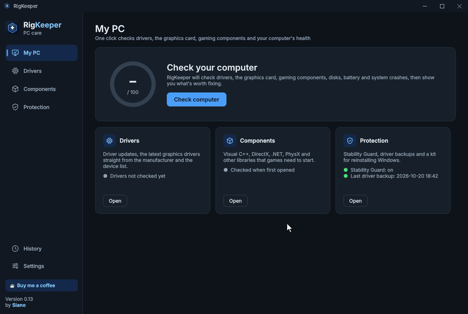

---

## ✨ Why RigKeeper?

Most "driver booster" tools are packed with ads, upsells and paywalled features.
**RigKeeper** does the useful part — finding outdated drivers, missing components and real problems on your PC —
and nothing else. No subscriptions, no "PRO" nag screens, no bundled junk.

And it goes a step further than the usual updaters: it **watches what happens after an update** and lets you
roll back a driver that made your PC less stable.

## 🚀 Features

- 🩺 **One-click PC check** – drivers, graphics card, game components, programs, disks, battery and system crashes in a single scan,
  with a **0–100 score** and a to-do list where every item has a button that fixes it
- 🔍 **Driver updates** – finds outdated, missing or faulty drivers and installs **certified, digitally signed drivers
  published by hardware manufacturers**; one driver or all of them at once
- 🖥️ **Graphics drivers straight from the vendor** – the latest **NVIDIA** driver downloaded from nvidia.com and installed
  silently (optional clean install); official tools for **AMD** and **Intel**
- 🎮 **Game components** – Visual C++ Redistributables, DirectX, .NET, XNA, OpenAL, PhysX, WebView2 and Vulkan,
  installed from official packages (PhysX is offered only on PCs with an NVIDIA card)
- 📦 **Program updates** – finds newer versions of your installed programs (7-Zip, VLC, Notepad++, Git…) in Microsoft's
  official package catalog and updates them silently; ignore the ones you want to keep as they are
- 🛡️ **Stability Guard** – saves your current driver before every update and watches the system log for 7 days
  (blue screens, unexpected shutdowns, graphics driver hangs). If things get worse, **roll back with one click**
- 🔧 **Fix device errors** – finds devices with an error in Device Manager (missing driver, code 43, disabled device…)
  and fixes them in one click: enables, restarts or reinstalls the device and tells you what it did
- 🧹 **Clean up unused devices** – removes leftovers of old USB drives, disks, mice and other hardware
  that is no longer connected (system entries are left alone by default)
- 💾 **Reinstall Kit** – put your drivers, game components, program list and settings on a USB drive and restore
  everything after reinstalling Windows
- 📋 **PC health report** – disk condition, free space, battery wear, recent crashes and antivirus status,
  exportable as an HTML report (handy for a repair shop)
- ⏪ **Safe by default** – a restore point before changes, driver backups, full history of every operation
- 🔔 **Runs quietly in the background** – tray icon, notifications and optional scheduled checks
- 🔄 **Signed automatic updates** – every new version is verified with a digital signature before it is installed
- 🌙 **Dark & light mode** – follows your Windows theme automatically
- 🌍 **7 languages** – English, Polski, Deutsch, Français, Español, Українська, Nederlands (picked automatically)
- 💸 **100% free** – no ads, no trials, no hidden paywall

## 📸 Screenshots

<picture>
  <source media="(prefers-color-scheme: light)" srcset="assets/screenshots/scan-light.png">
  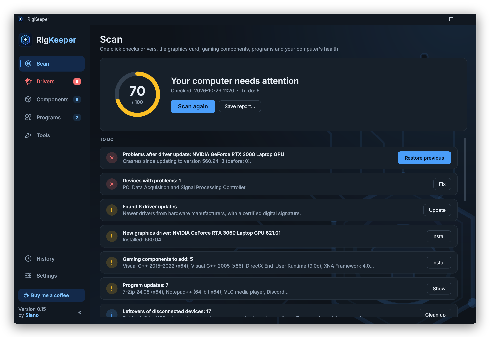
</picture>

  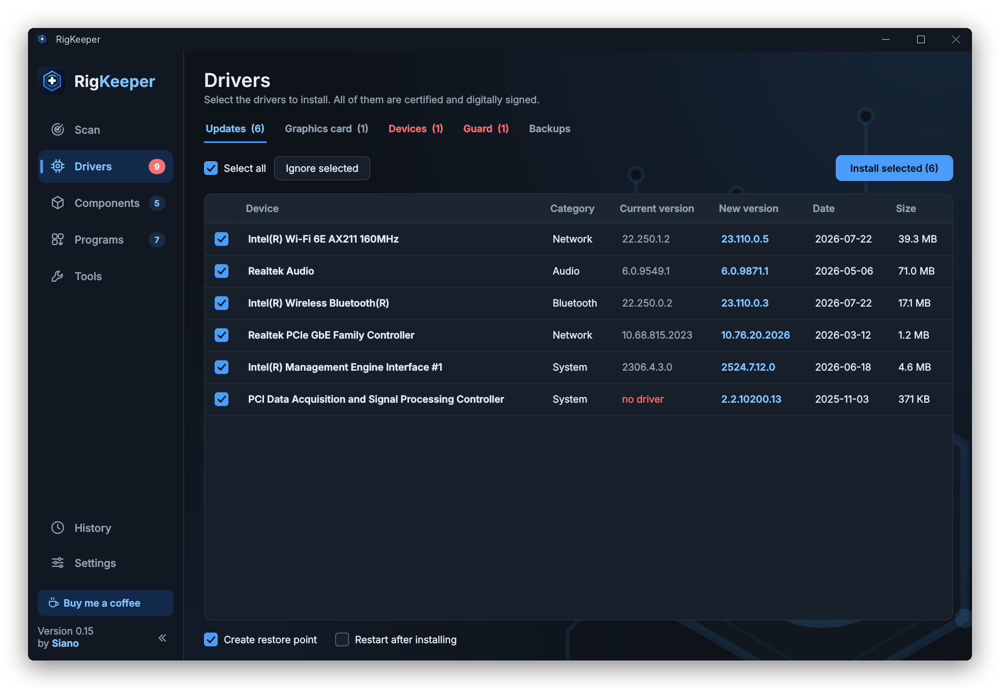
  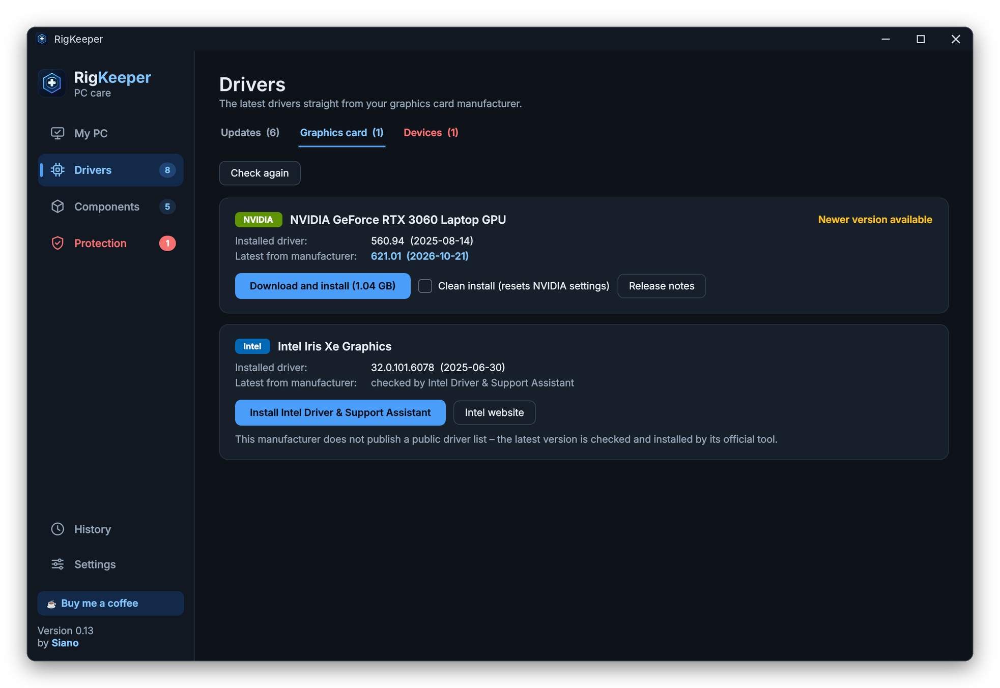

  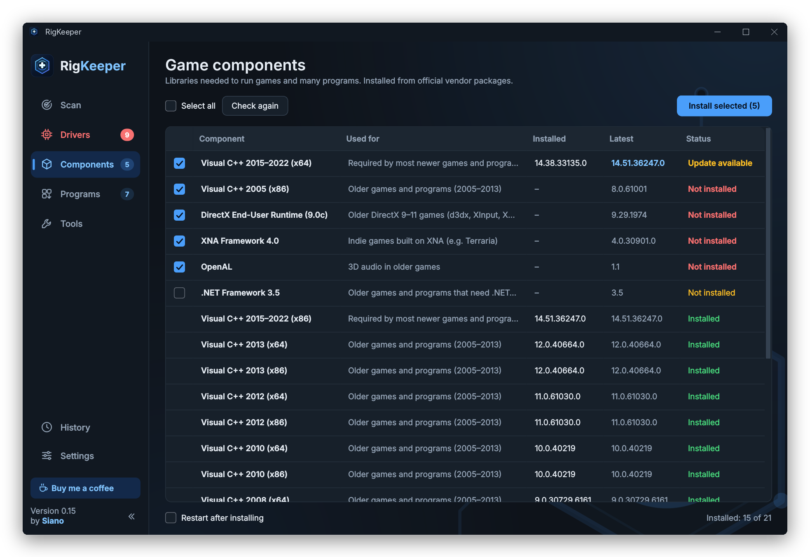
  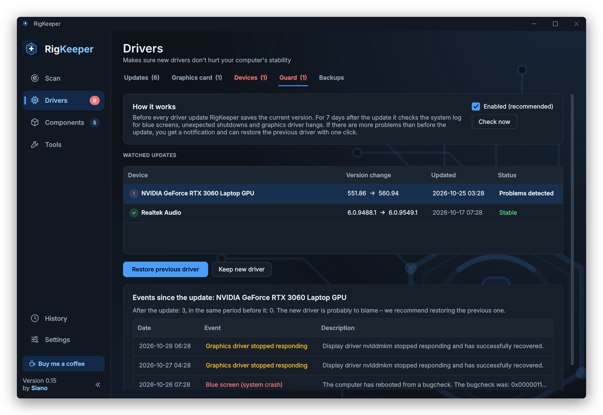

  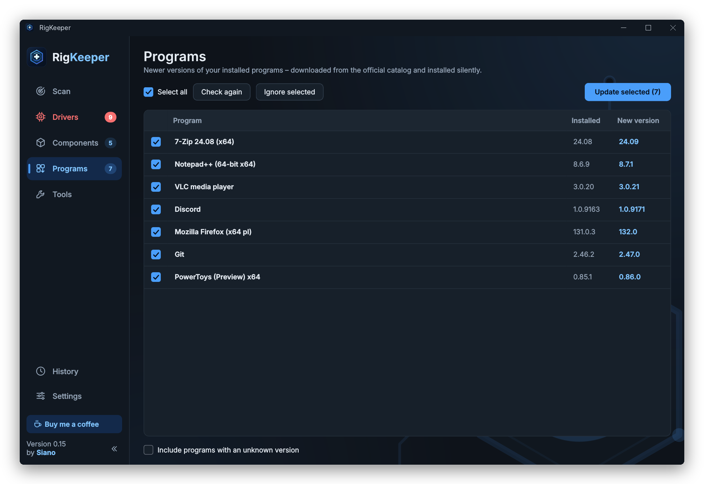
  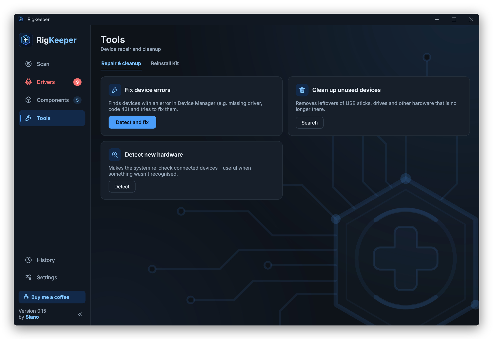

  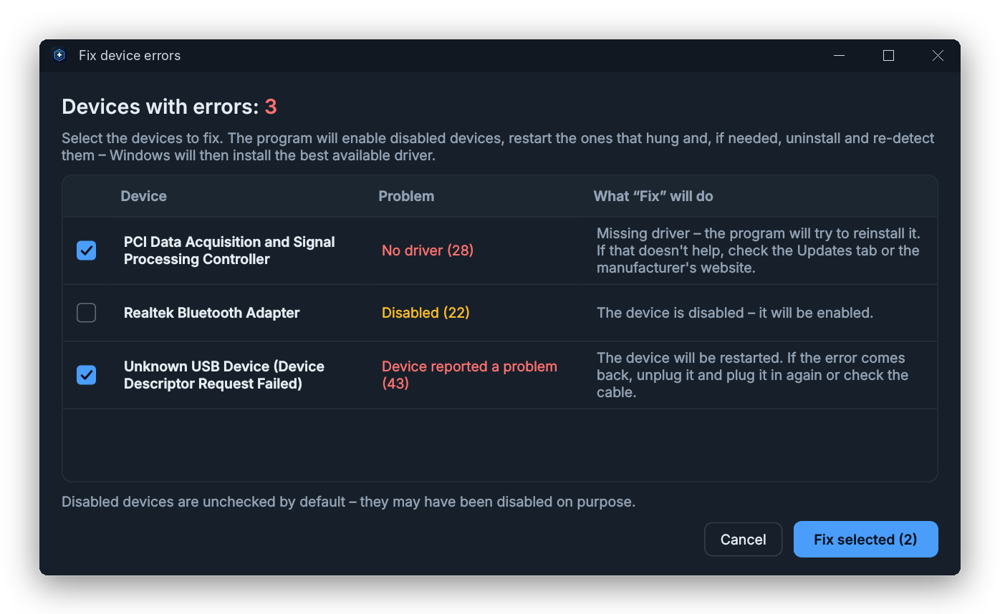
  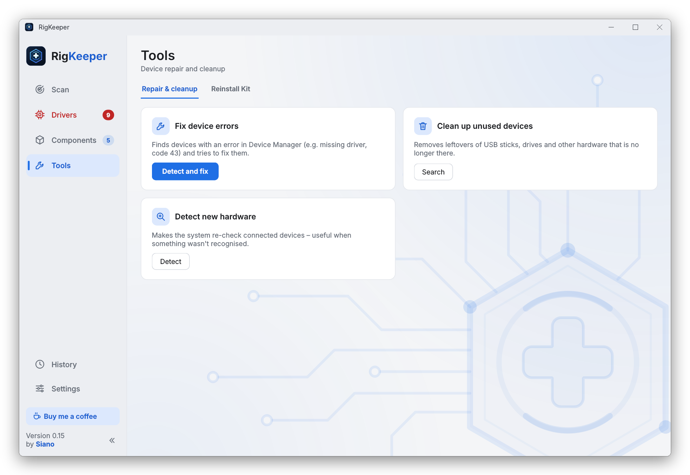

  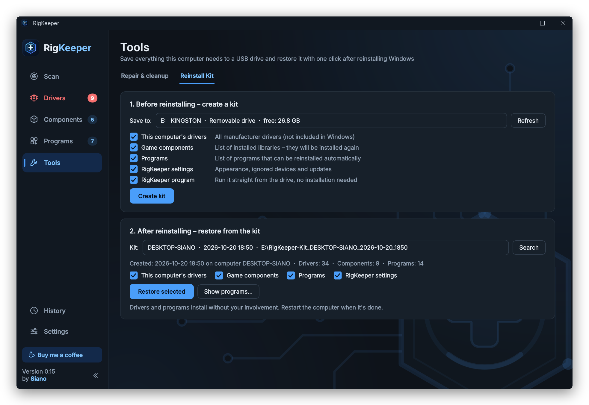
  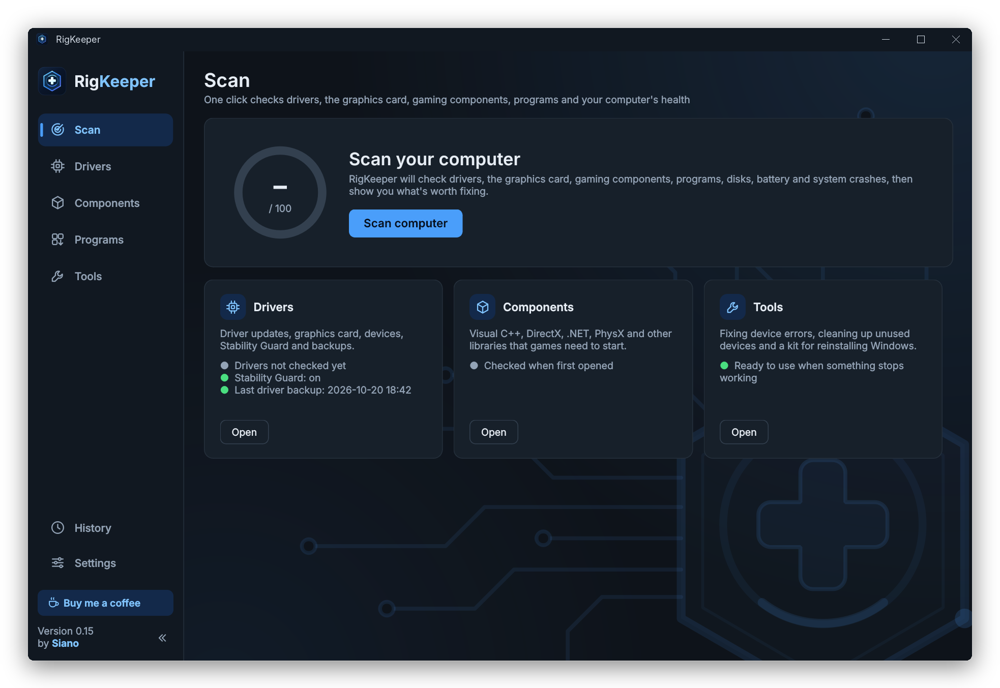

## 📦 Download

Grab the latest build from the [**Releases**](../../releases/latest) page, run `RigKeeper_Setup_x.y.exe` and you're good to go.
Once installed, RigKeeper updates itself.

> ⚠️ RigKeeper is still **before version 1.0**. It works, but expect rough edges.
> Bug reports are very welcome!
>
> Windows SmartScreen may warn you about an unknown publisher — the installer is not code-signed yet.
> Click **More info → Run anyway**.

### Requirements

- Windows 10 or Windows 11 (64-bit)
- Administrator rights (needed to install drivers)
- Internet connection

## 🔒 Privacy

RigKeeper does **not** collect or send any personal data, usage statistics or telemetry.
It only connects to the internet to check for its own updates (GitHub), to download drivers and components
from their manufacturers (e.g. NVIDIA, Microsoft) and to search for drivers through Windows.

## 🛠️ How it works

1. **Check** – one click reads your devices, drivers, graphics card, installed components and programs, disks, battery and the system log.
2. **Review** – you get a score and a short to-do list: what's outdated, missing or broken, and why it matters.
3. **Fix** – you choose what to update or repair; a restore point and a backup of the current driver are created first.
4. **Watch** – for the next 7 days Stability Guard checks that the new drivers behave. If not, roll back with one click.

## 🗺️ Roadmap

- [x] Driver scan & update
- [x] Dark mode
- [x] Game components manager
- [x] Scheduled background checks
- [x] Driver backup & restore
- [x] Graphics drivers straight from NVIDIA
- [x] Stability Guard (automatic rollback suggestions)
- [x] Reinstall Kit (USB)
- [x] PC health score & report
- [x] Signed automatic updates
- [x] Fix device errors & clean up unused devices
- [x] Program updates
- [ ] Code-signed installer
- [ ] Available via `winget`
- [ ] **Stable 1.0 release**

## 🐞 Reporting issues

Found a bug or a driver that won't update? [Open an issue](../../issues) and include:
- your Windows version,
- the device / driver in question,
- a screenshot or the log file, if possible (logs are in `%APPDATA%\RigKeeper\logi`).

## ☕ Support

RigKeeper is free and always will be. If it saved you some time, you can buy me a coffee — thank you!

  

<b>Crypto</b> (BTC · ETH · USDT TRC-20)

 

| | Network | Address |
|---|---|---|
|  | **Bitcoin (BTC)** | `bc1qtxed92cmpf62em3xu06lcshtxm8g9nuydv2rvj` |
|  | **Ethereum (ETH)** – ERC-20 only | `0x3f402e2a2e1DB1aCCE1b5aAF8f11a29937599c27` |
|  | **Tether (USDT)** – TRON (TRC-20) only | `TGVWRMR7VhTrHrFqUsZYpxkHoDS5ogVsjr` |

Please send only on the network listed next to each address.

You'll also find the ☕ button right in the app.

## 📄 License

RigKeeper is **freeware** – free to use at home and at work, free to share in its original form.
See [LICENSE](LICENSE) for the full terms.
RigKeeper is built with open-source components (Qt / PySide6 under LGPL-3.0, Python, cryptography) –
see [THIRD-PARTY-NOTICES.txt](THIRD-PARTY-NOTICES.txt). Drivers installed by RigKeeper belong to their manufacturers.

---

  Made with ☕ by <b>Siano</b> · <a href="mailto:siano19@gmail.com">siano19@gmail.com</a>

